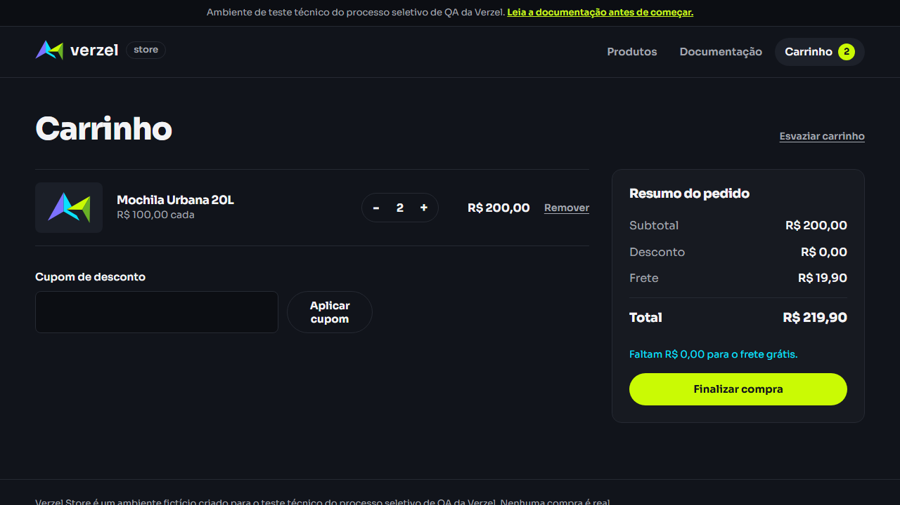
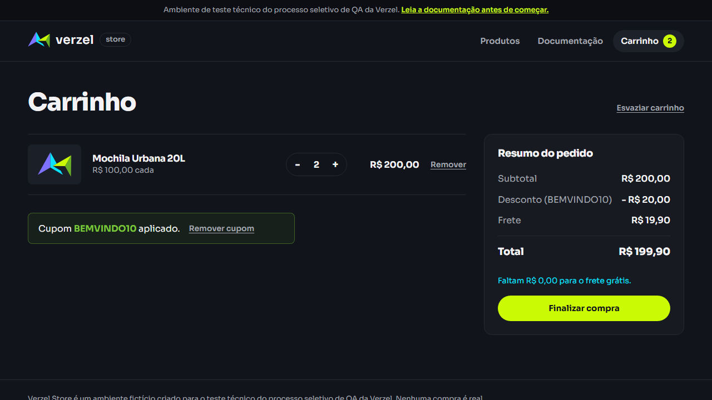
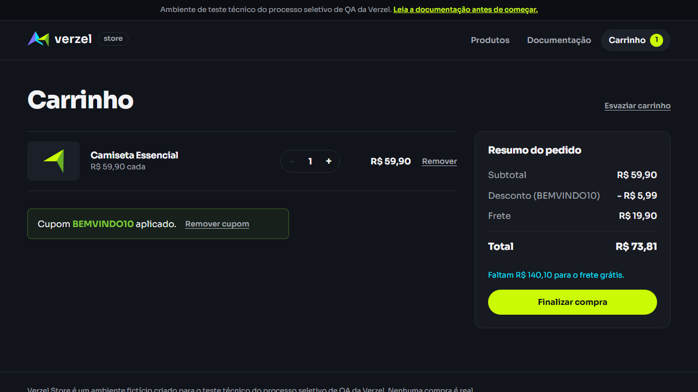
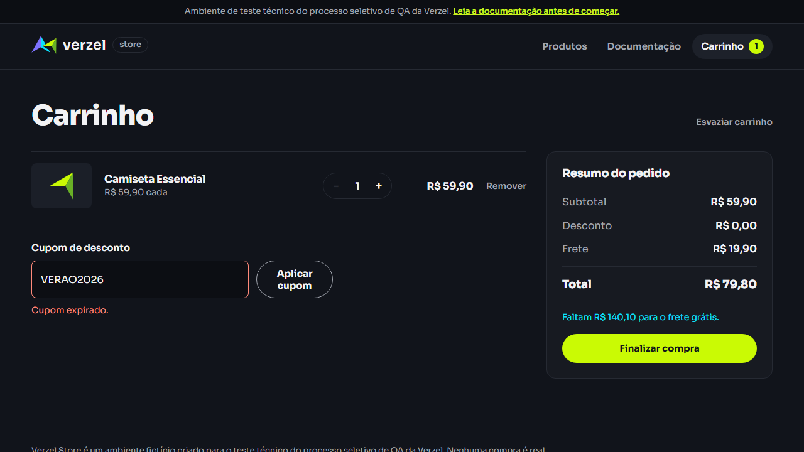
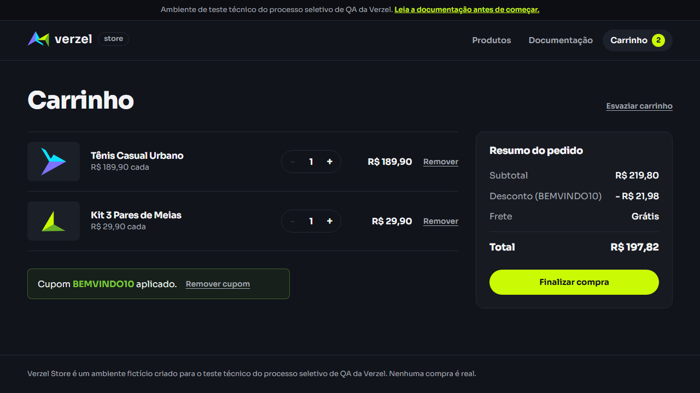
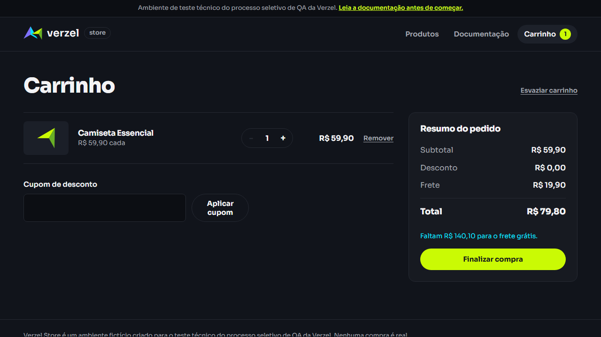
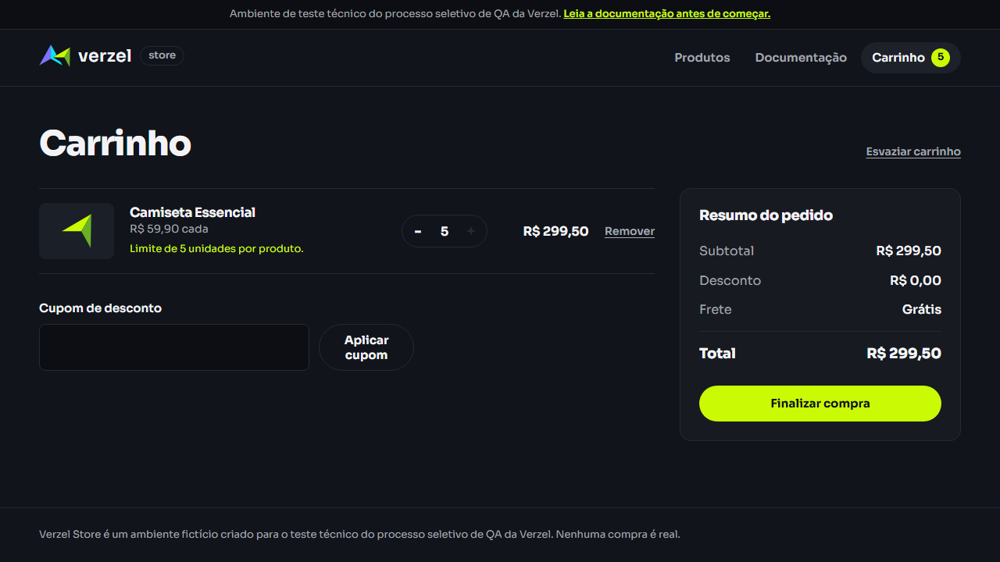
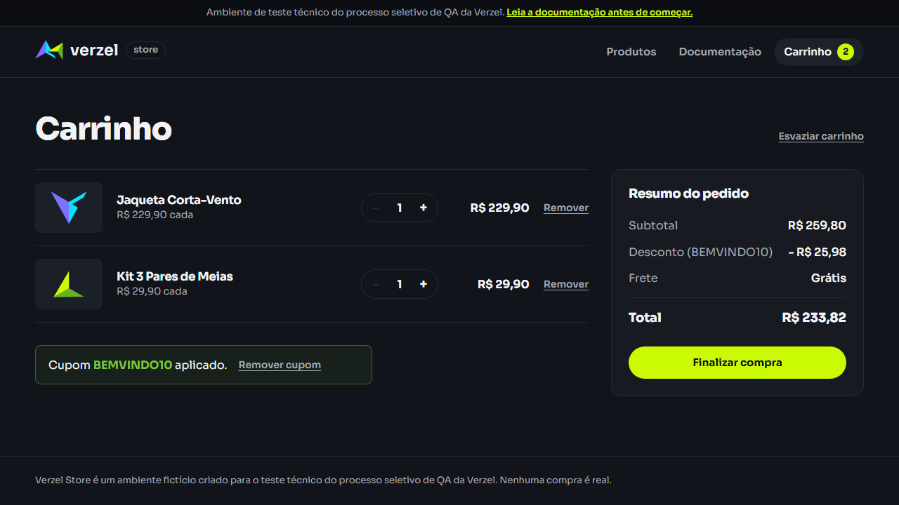

# 📸 Evidências da Execução

**Projeto:** Verzel Store – Entrega VZS-142 · **Versão:** 2.3.0 · **Data:** 09/10/2026
**Resultado:** 17 passaram · 3 falharam (BUG-001 ×2, BUG-002 ×1)

Relatórios relacionados: [Relatório de execução](relatorio-de-execucao.md) · [Report de bugs](report-de-bugs.md)

> Capturas de tela geradas automaticamente pelo Playwright (`screenshot: 'on'`) e salvas em [`evidencias/`](evidencias/). Para regerar: veja [Como regerar](#-como-regerar-as-evidências).

---

## 🐞 Evidências dos bugs

### BUG-001 – Frete cobrado com subtotal de R$ 200,00

| CT-E2E-07 – sem cupom | CT-E2E-08 – com `BEMVINDO10` |
|---|---|
|  |  |
| Esperado: frete **Grátis**, total R$ 200,00 | Esperado: frete **Grátis**, total R$ 180,00 |

### BUG-002 – API aceita 6 unidades (CT-API-03)

Resposta completa em [`api-respostas.txt`](evidencias/api-respostas.txt). Trecho:

```
POST /api/carrinho/calcular  {"itens":[{"produtoId":"P001","quantidade":6}]}
→ HTTP 200   (esperado: 422 QUANTIDADE_MAXIMA_EXCEDIDA)
{"itens":[{"produtoId":"P001","quantidade":6,"total":359.4}],"subtotal":359.4,"frete":0,"total":359.4,"cupom":null}
```

---

## ✅ Evidências dos testes que passaram – Interface (E2E)

| Teste | CA | Captura |
|---|---|---|
| **CT-E2E-01** – `BEMVINDO10`: 10% sobre o subtotal, frete intacto | CA01, CA09 |  |
| **CT-E2E-02** – `bemvindo10` | CA02 |  |
| **CT-E2E-02** – `  BEMVINDO10  ` | CA02 |  |
| **CT-E2E-02** – `BemVindo10` | CA02 |  |
| **CT-E2E-03** – cupom inexistente: "Cupom inválido." | CA03 |  |
| **CT-E2E-04** – cupom expirado: "Cupom expirado." | CA04 |  |
| **CT-E2E-05** – troca de cupom | CA05 |  |
| **CT-E2E-06** – reaplicar cupom não acumula | CA05 |  |
| **CT-E2E-09** – frete grátis mantido (subtotal R$ 219,80 + cupom) | CA08 |  |
| **CT-E2E-10** – frete R$ 19,90 e valor faltante | CA07 |  |
| **CT-E2E-11** – limite de 5 unidades na interface | CA10 |  |
| **CT-E2E-12** – 2 casas decimais com cupom e frete grátis | CA11 |  |

---

## 🔌 Evidências dos testes de API

Requisições e respostas reais (status HTTP + corpo) em [`evidencias/api-respostas.txt`](evidencias/api-respostas.txt).

| Teste | CA | Requisição | Status obtido | Resultado |
|---|---|---|:-:|:-:|
| **CT-API-01** | CA03 | `calcular` com `CUPOMINEXISTENTE` | 200 · `aplicado:false` · "Cupom inválido." | ✅ |
| **CT-API-02** | CA04 | `calcular` com `VERAO2026` | 200 · `aplicado:false` · "Cupom expirado." | ✅ |
| **CT-API-03** | CA10.1 | `calcular` com `quantidade: 6` | **200** (esperado 422) | ❌ BUG-002 |
| **CT-API-04** | CA11 | `calcular` P002 + 2×P004 + `BEMVINDO10` | 200 · 239,70 / 23,97 / 0,00 / 215,73 | ✅ |
| **CT-API-05** | CA03.1 | `pedidos` com `CUPOMINEXISTENTE` | 422 · `CUPOM_INVALIDO` | ✅ |
| **CT-API-06** | CA04.1 | `pedidos` com `VERAO2026` | 422 · `CUPOM_EXPIRADO` | ✅ |
| Exploratório | CA10.1 | `calcular` com `quantidade: 0` / `1.5` | 422 · `QUANTIDADE_INVALIDA` | ✅ |

---

## 📂 Arquivos gerados

| Arquivo / pasta | Conteúdo |
|---|---|
| `docs/evidencias/*.png` | Screenshots de cada teste E2E |
| `docs/evidencias/api-respostas.txt` | Requisições e respostas da API |
| `e2e/playwright-report/index.html` | Relatório HTML navegável (abrir com `npx playwright show-report`) |
| `e2e/evidencias/artefatos/` | Screenshots e traces brutos da execução |
| `e2e/evidencias/resultado.json` | Resultado completo em JSON |

## 🔁 Como regerar as evidências

```bash
cd e2e
npx playwright test -c playwright.evidencias.config.ts   # screenshots, trace e relatório HTML
npx playwright show-report                                # abre o relatório no navegador
```
